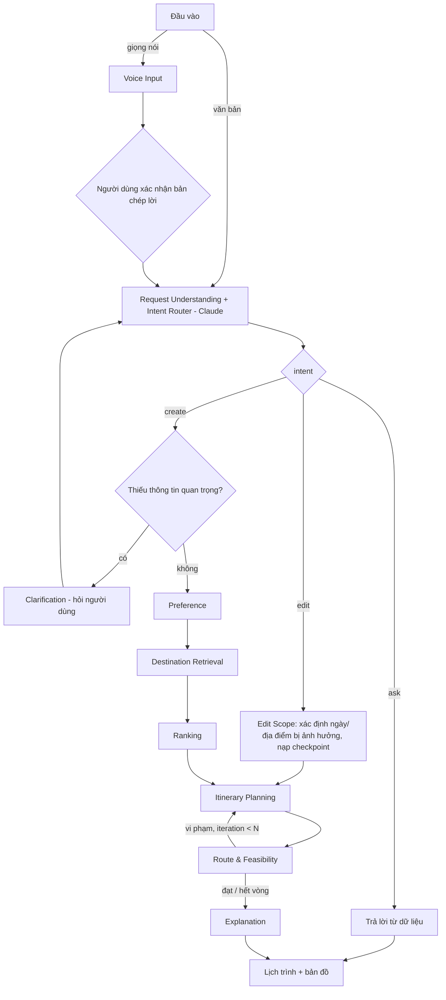

# Hệ thống lập kế hoạch du lịch cá nhân hóa

**Personalized Travel Planning System Based on Context Understanding, Geographic Knowledge and Itinerary Optimization**

> Tài liệu thiết kế kỹ thuật — phiên bản 0.3 (11/2026). Thay đổi so với 0.2: định nghĩa `TripSpec`/`DayContext`, thêm nhánh sửa lịch vào đồ thị, làm rõ nguồn mô tả địa điểm và dữ liệu giá, thu hẹp vai trò MCP, lộ trình có lát cắt dọc sớm.
> Toàn bộ kiến trúc, công nghệ và thuật toán dưới đây là **đề xuất thiết kế**, chưa triển khai và chưa kiểm chứng. Không có số liệu thực nghiệm hay chi phí API; mọi khẳng định về hiệu quả phải được chứng minh bằng thực nghiệm (mục 10).

---

## Mục lục

1. [Tổng quan](#1-tổng-quan)
2. [Nguyên tắc thiết kế](#2-nguyên-tắc-thiết-kế)
3. [Công nghệ sử dụng](#3-công-nghệ-sử-dụng)
4. [Kỹ thuật và thuật toán](#4-kỹ-thuật-và-thuật-toán)
5. [Xử lý giọng nói và ghi âm](#5-xử-lý-giọng-nói-và-ghi-âm)
6. [Kiến trúc Multi-Agent](#6-kiến-trúc-multi-agent)
7. [Model Context Protocol (MCP)](#7-model-context-protocol-mcp)
8. [Luồng xử lý tổng thể](#8-luồng-xử-lý-tổng-thể)
9. [Dữ liệu và lưu trữ](#9-dữ-liệu-và-lưu-trữ)
10. [Phương pháp đánh giá](#10-phương-pháp-đánh-giá)
11. [Phạm vi và lộ trình](#11-phạm-vi-và-lộ-trình)
12. [Insight, rủi ro và việc cần làm](#12-insight-rủi-ro-và-việc-cần-làm)
13. [Cấu trúc repo đề xuất](#13-cấu-trúc-repo-đề-xuất)
14. [Thuật ngữ](#14-thuật-ngữ)

---

## 1. Tổng quan

Người dùng mô tả chuyến đi bằng **văn bản hoặc giọng nói** (tiếng Việt tự nhiên). Hệ thống hiểu nhu cầu, hoàn cảnh, sở thích và mức ưu tiên, rồi lập **lịch trình theo ngày** dựa trên dữ liệu địa điểm và ràng buộc kiểm chứng được.

**Ví dụ yêu cầu (có thể nói qua micro):**

> “Chuyến đi 4 người cùng gia đình tại Nha Trang, 3 ngày. Ngày đầu mới đi xe một đêm nên mệt, chỉ muốn đi chơi gần khách sạn, đơn giản. Ngày hai đưa gia đình đi chơi, ăn uống, tham quan cả ngày. Ngày cuối muốn làm điều gì đó thật đáng nhớ.”

| Yếu tố | Hệ thống hiểu được |
|---|---|
| Địa điểm, thời gian | Nha Trang; 3 ngày |
| Số người, nhóm khách | 4 người; gia đình |
| Ngày 1 | Mệt → cường độ thấp, bán kính nhỏ quanh khách sạn |
| Ngày 2 | Nhiều hoạt động, tham quan + ẩm thực |
| Ngày 3 | Trải nghiệm đặc biệt; chú ý giờ về |

**Mục tiêu nghiên cứu**

1. Thu thập, làm sạch, chuẩn hóa và tổ chức dữ liệu du lịch.
2. Tiếp nhận yêu cầu bằng văn bản và giọng nói tiếng Việt.
3. Hiểu ngữ cảnh, mô hình hóa mức độ ưu tiên của người dùng.
4. Xây dựng tri thức địa lý về địa điểm và các quan hệ.
5. Tìm kiếm và xếp hạng địa điểm (Hybrid Retrieval + đa tiêu chí).
6. Tối ưu lịch trình nhiều ngày theo thời gian, khoảng cách, cường độ.
7. Điều phối bằng kiến trúc Multi-Agent, công cụ mở qua MCP.
8. Giải thích kết quả và đánh giá chất lượng, tính khả thi.

---

## 2. Nguyên tắc thiết kế

| # | Nguyên tắc | Hệ quả |
|---|---|---|
| 1 | **LLM hiểu, thuật toán tính** | Claude chỉ đọc hiểu, suy luận nhu cầu, trả JSON. Khoảng cách, tuyến đường, giờ mở cửa, điểm số do code xác định xử lý. |
| 2 | **Mọi kết quả kiểm chứng được** | Mỗi địa điểm trong lịch trình có nguồn dữ liệu; mỗi lý do giải thích trỏ về dữ liệu thật. |
| 3 | **Không tự giả định** | Thông tin người dùng không nhắc (nhóm C) không được cộng điểm; thuộc tính dữ liệu thiếu được đánh dấu “chưa xác minh”. |
| 4 | **Core trước, Advanced sau** | Chỉ thêm công nghệ khi thực nghiệm chỉ ra hạn chế cụ thể của Core. |
| 5 | **Công cụ là ranh giới** | LLM chỉ chạm dữ liệu qua công cụ có lược đồ (MCP), không truy vấn tự do. Module xác định (không phải LLM) gọi thẳng thư viện Python dùng chung với MCP server, không đi vòng qua giao thức. |
| 6 | **Riêng tư mặc định** | Ghi âm chỉ khi người dùng bấm; file âm thanh xóa sau khi chuyển văn bản (trừ khi đồng ý lưu). |

---

## 3. Công nghệ sử dụng

### 3.1. Phân biệt khái niệm

| Khái niệm | Là gì | Vai trò trong hệ thống |
|---|---|---|
| LLM | Mô hình đọc hiểu và sinh văn bản; kết quả mang tính xác suất | Hiểu yêu cầu, phân loại ưu tiên, tạo JSON, gọi công cụ |
| NLP | Lĩnh vực xử lý ngôn ngữ, gồm cả mô hình nhỏ (PhoBERT) | Nhận diện thực thể tiếng Việt; đối chứng với LLM |
| ASR / STT | Nhận dạng tiếng nói → văn bản | Chuyển bản ghi âm thành câu yêu cầu |
| Rule Engine | Chương trình áp dụng quy tắc xác định | Kiểm tra ràng buộc, chuẩn hóa, lọc bắt buộc |
| Agent | Thành phần phụ trách một nhiệm vụ, dùng trạng thái chung | Chia quy trình thành bước; **không bắt buộc là LLM** |
| MCP | Giao thức chuẩn để LLM/ứng dụng gọi công cụ và đọc tài nguyên | Đóng gói truy vấn địa điểm, định tuyến, lập lịch thành công cụ |
| Knowledge Graph | Tri thức dạng nút và quan hệ | Quan hệ địa điểm – khu vực – hoạt động |
| Vector Database | Lưu vector biểu diễn ý nghĩa | Tìm theo mô tả “yên tĩnh, hợp gia đình” |
| Thuật toán tối ưu | Tìm phương án tốt theo ràng buộc | Phân bổ địa điểm theo ngày, sắp thứ tự |

### 3.2. Danh sách công nghệ

| Nhóm | Công nghệ | Mức | Vai trò |
|---|---|---|---|
| LLM | **Claude API** (Anthropic) | Core | Hiểu ngôn ngữ, phân loại ưu tiên A/B/C, gọi công cụ, trả JSON theo lược đồ |
| Giọng nói (STT) | **PhoWhisper** / **faster-whisper** | Core | Chuyển ghi âm tiếng Việt thành văn bản, chạy cục bộ |
| Phát hiện tiếng nói | Silero VAD | Core | Cắt khoảng lặng, giảm nhiễu đầu vào STT |
| Xử lý âm thanh | FFmpeg | Core | Chuyển định dạng về WAV 16 kHz mono |
| Ghi âm trình duyệt | Web MediaRecorder API | Core | Ghi âm trên web (webm/opus) |
| Đọc kết quả (TTS) | TTS tiếng Việt | Advanced | Đọc lịch trình bằng giọng nói |
| NLP | PhoBERT / BERT | Advanced | NER tiếng Việt, đối chứng với LLM |
| Rule Engine | Python + Pydantic | Core | Kiểm tra lược đồ, quy đổi ưu tiên thành bộ lọc/trọng số |
| Multi-Agent | **LangGraph** | Core | Đồ thị trạng thái, rẽ nhánh, vòng lặp sửa lịch, điểm hỏi lại người dùng |
| Giao thức công cụ | **MCP** (Python SDK) | Core | Máy chủ công cụ: địa điểm, định tuyến, lập lịch, thời tiết |
| Dữ liệu địa lý | OpenStreetMap (ODbL) | Core | Địa điểm, tọa độ, đường sá |
| Định tuyến | OSRM / GraphHopper (tự host) | Core | Tuyến đường và thời gian di chuyển thật |
| CSDL quan hệ | **MySQL 8.4** (kiểu `POINT` SRID 4326 + `SPATIAL INDEX`) | Core | Nguồn dữ liệu chuẩn, truy vấn không gian (`ST_Distance_Sphere`, `MBRContains`) |
| Tìm kiếm vector | Vector lưu trong MySQL (BLOB float32) + cosine brute-force bằng NumPy trong bộ nhớ (Core) / Qdrant (Advanced) | Core | Tìm kiếm ngữ nghĩa. Quy mô vài nghìn địa điểm nên quét toàn bộ đủ nhanh; Qdrant khi cần chỉ mục xấp xỉ |
| Embedding | **AITeamVN/Vietnamese_Embedding** (mô hình chính); **BAAI/bge-m3** (baseline); **multilingual-e5-large-instruct** (đối chứng) | Core | Sinh vector cho mô tả địa điểm và câu truy vấn, chạy cục bộ (Claude API không cung cấp embedding). Xem mục 4.4 |
| Knowledge Graph | Neo4j | Advanced | Quan hệ địa điểm, khu vực, hoạt động |
| Tối ưu | Heuristic Python (Core) / Google OR-Tools (Advanced) | Core | Lập lịch nhiều ngày |
| Backend | Python + FastAPI | Core | REST API, WebSocket/SSE trả tiến trình |
| Frontend | React / Next.js + bản đồ (Leaflet/MapLibre) | Core | Nhập văn bản/ghi âm, hiển thị lịch trình và bản đồ |
| Cache / hàng đợi | Redis | Tùy chọn | Lưu đệm kết quả Claude, hàng đợi tác vụ STT. Bản Core không cần Redis: STT chạy nền bằng FastAPI background task, checkpoint LangGraph lưu bằng SQLite hoặc MySQL (chọn ở GĐ 4, mục 6.5) |
| Lưu trữ thô | MinIO | Tùy chọn | Dữ liệu gốc, âm thanh (nếu được đồng ý) |
| Pipeline dữ liệu | Makefile + script Python idempotent (Core) / Apache Airflow (Advanced) | Core / Advanced | Thu thập, làm sạch, nạp DB, embedding. Airflow chỉ bọc các bước này thành DAG khi cần cập nhật định kỳ/nhiều thành phố (mục 8.1) |
| Giám sát | Prometheus + Grafana | Advanced | Tiến trình, lỗi, hiệu năng, token |
| Đóng gói | Docker Compose | Core | Chạy MySQL, OSRM, backend, frontend cùng lúc |

### 3.3. Quy định về Claude API

- Claude là LLM chính của kiến trúc, không thay bằng mô hình khác.
- Claude đảm nhận: phân tích ngữ nghĩa, ngữ cảnh, suy luận nhu cầu, quyết định **gọi công cụ nào** (qua MCP/tool use), tạo kết quả có cấu trúc, viết lời giải thích từ dữ liệu đã có.
- Claude **không**: tính tuyến đường, kiểm tra giờ mở cửa, cho điểm số, bịa địa điểm. Mọi con số đến từ công cụ.
- Kiểm soát chi phí: chỉ gọi khi cần hiểu ngôn ngữ; giới hạn độ dài; ép đầu ra JSON theo lược đồ; cache theo hash của câu yêu cầu đã chuẩn hóa; ghi nhật ký token mỗi lần gọi. Chi phí chưa đo nên không nêu số.

---

## 4. Kỹ thuật và thuật toán

### 4.1. Kỹ thuật

| Nhóm | Kỹ thuật | Nguyên lý / ví dụ |
|---|---|---|
| Giọng nói | Speech-to-Text | Ghi âm → văn bản tiếng Việt |
| | Voice Activity Detection | Bỏ khoảng lặng, tiếng ồn đầu/cuối |
| | Chuẩn hóa văn bản sau STT | “bốn người” → 4; “ba ngày hai đêm” → 3 ngày |
| | Hiệu chỉnh tên riêng | So khớp mờ tên địa danh với gazetteer (nạp vào bộ nhớ, so khớp bằng `rapidfuzz`; MySQL không có `pg_trgm`) (“hòn chồng” → Hòn Chồng) |
| Ngôn ngữ | NER | “Nha Trang” → địa điểm; “4 người” → số người |
| | Intent Classification | “lập lịch nhiều ngày”, “sửa ngày 2”, “hỏi thông tin” |
| | Semantic Understanding | “nhẹ nhàng” → cường độ thấp; “gần khách sạn” → giới hạn bán kính |
| | Preference Modeling | Tách bắt buộc / sở thích / không đề cập (mục 4.3) |
| | Clarification | Hỏi lại khi thiếu thông tin ảnh hưởng lớn (ngân sách, ngày đi) |
| Tác tử | Multi-Agent Orchestration | Đồ thị trạng thái, mỗi agent ghi trường của mình |
| | Tool Use qua MCP | LLM gọi công cụ có lược đồ thay vì tự tính |
| | Human-in-the-loop | Người dùng xác nhận bản chép lời, trả lời câu hỏi làm rõ |
| Dữ liệu | Rule-based Processing | Loại địa điểm đóng cửa vào giờ dự kiến đến |
| | Knowledge Graph Construction | Bảng địa điểm → nút và quan hệ |
| | Spatial Analysis | Lọc trong bán kính quanh khách sạn (MySQL: lọc khung bao bằng `MBRContains` rồi `ST_Distance_Sphere`) |
| | Hybrid Retrieval | SQL (điều kiện) + vector (ý nghĩa) + đồ thị (quan hệ), hợp nhất bằng RRF |
| Ra quyết định | Multi-Criteria Decision Making | Chấm điểm có trọng số |
| | Route Optimization | Sắp thứ tự thăm để giảm di chuyển mà vẫn thỏa ràng buộc |
| | Day Energy Budget | Mỗi ngày có ngân sách năng lượng: số điểm, bán kính, tổng giờ hoạt động |
| | Explainable Recommendation | Gắn lý do kiểm chứng được cho mỗi lựa chọn |

### 4.2. Thuật toán

| Thuật toán | Dùng để | Giới hạn |
|---|---|---|
| Haversine | Khoảng cách đường chim bay | Không phản ánh quãng đường thật |
| Dijkstra / A* (trong OSRM) | Tìm đường trên mạng giao thông | Không tính tắc đường thực tế |
| WSM | Điểm = Σ trọng số × điểm chuẩn hóa | Điểm cao bù điểm thấp; nhạy với trọng số |
| TOPSIS | Xếp hạng đối chứng với WSM | Cũng nhạy với trọng số, chuẩn hóa |
| Cosine Similarity | Độ gần giữa vector | Phụ thuộc chất lượng embedding |
| Reciprocal Rank Fusion | Hợp nhất kết quả nhiều nguồn tìm kiếm | Bỏ qua độ lớn điểm gốc |
| Greedy + 2-opt | Baseline lập lịch Core | Không đảm bảo tối ưu |
| Google OR-Tools (VRP có khung giờ) | Tối ưu lịch nhiều ràng buộc (Advanced) | Thường chỉ ra lời giải tốt trong thời gian giới hạn |
| Levenshtein / so khớp mờ | Sửa tên địa danh sau STT | Có thể khớp nhầm tên gần giống |
| WER / CER | Đo lỗi nhận dạng giọng nói | Không phản ánh lỗi ngữ nghĩa |

> Bài toán lập lịch du lịch thuộc họ bài toán khó (orienteering, tourist trip design) và thường giải bằng heuristic. “Tối ưu” chỉ đúng theo hàm mục tiêu và ràng buộc đã định nghĩa.

### 4.3. Mô hình ưu tiên A/B/C

| Nhóm | Ví dụ | Cách xử lý |
|---|---|---|
| **A – Hard Constraints** | Phải ở Nha Trang; đúng 3 ngày; giờ về cố định; ràng buộc sức khỏe/ăn kiêng | Bộ lọc cứng, loại phương án vi phạm |
| **B – Soft Preferences** | Thích biển, ưu tiên hải sản, nơi ít đông, ngày đầu nhẹ nhàng | Tiêu chí có trọng số để chấm điểm |
| **C – Unmentioned** | Ngân sách, ẩm thực… không nhắc | Không cộng điểm; hỏi lại nếu ảnh hưởng lớn |

**Ngân sách:** OSM không có giá, nên ngân sách **không** là ràng buộc cứng toàn cục. Chỉ địa điểm đã khảo sát giá (`price_verified = true`) mới được kiểm tra theo ngân sách; địa điểm chưa có giá bị trừ điểm nhẹ và gắn nhãn “chưa rõ giá”, không bị loại.

**Nhóm khách:** nhãn như “gia đình có trẻ nhỏ”, “cặp đôi”, “người lớn tuổi” được ánh xạ sang thuộc tính dữ liệu bằng bảng cố định (ví dụ trẻ nhỏ → `kid_friendly`, tránh `high_intensity`; người lớn tuổi → ít bậc thang, ít đi bộ). Bảng này nằm trong `policy://preference-weights`.

Phân công: Claude gán nhóm, mức ưu tiên (cao/trung bình/thấp), trích đoạn căn cứ và độ chắc chắn → Rule Engine đổi A thành bộ lọc, B thành trọng số theo bảng quy đổi cố định → WSM/TOPSIS chấm điểm.

### 4.4. Mô hình embedding

| Vai trò | Mô hình | Lý do |
|---|---|---|
| **Chính** | AITeamVN/Vietnamese_Embedding | Mô hình dành riêng cho tiếng Việt |
| **Baseline** | BAAI/bge-m3 | Mô hình đa ngôn ngữ phổ biến, mốc so sánh chuẩn |
| **Đối chứng** | multilingual-e5-large-instruct | Họ mô hình khác (E5, có tiền tố chỉ dẫn), kiểm tra kết quả không phụ thuộc một họ mô hình |

Thiết kế để thay mô hình được mà không sửa code truy xuất:
- Mỗi mô hình có **bảng/cột vector riêng** trong MySQL (bảng `place_embedding(place_id, model, dim, vector BLOB)`, vector float32 đã L2-normalize). Khi khởi động, nạp ma trận vector của từng mô hình vào bộ nhớ; truy vấn là tích vô hướng với ma trận (NumPy), lấy top-k. Nếu dữ liệu lớn lên đáng kể thì chuyển sang Qdrant.
- Lớp `Embedder` chung, cấu hình qua biến môi trường `EMBEDDING_MODEL`. Mỗi mô hình khai báo tiền tố truy vấn/tài liệu riêng (E5-instruct cần câu chỉ dẫn cho truy vấn; kiểm tra model card của từng mô hình khi cài đặt, không giả định).
- Chuẩn hóa vector (L2) và dùng cosine thống nhất cho cả ba.
- Chạy cục bộ, có GPU thì dùng GPU; nếu không thì sinh embedding một lần lúc nạp dữ liệu (số địa điểm Nha Trang nhỏ nên chấp nhận được), chỉ truy vấn mới cần mã hóa lúc chạy.

**Thực nghiệm:** chạy đủ ba mô hình trên bộ eval ở GĐ 2, đo Precision@K, Recall@K, NDCG@K cho semantic search và hybrid. Mô hình chính được giữ nếu không kém baseline; nếu kém, quyết định đổi mô hình chính dựa trên số liệu và ghi vào ADR. Chưa có kết quả nào; việc mô hình chuyên tiếng Việt có tốt hơn hay không cần chứng minh bằng thực nghiệm.

---

## 5. Xử lý giọng nói và ghi âm

### 5.1. Trải nghiệm người dùng

1. Người dùng bấm nút micro → trình duyệt xin quyền micro.
2. Ghi âm, hiển thị sóng âm và thời lượng; giới hạn mặc định 120 giây.
3. Bấm dừng → tải lên backend.
4. Hệ thống trả **bản chép lời** cho người dùng xem và **sửa trước khi gửi** (human-in-the-loop).
5. Văn bản đã xác nhận đi vào luồng xử lý như yêu cầu gõ tay.
6. Có thể ghi âm tiếp để sửa lịch: “đổi ngày 2 sang đi đảo”.

### 5.2. Pipeline

```
Trình duyệt (MediaRecorder, webm/opus)
   │  POST /api/voice  (multipart)
   ▼
FFmpeg  →  WAV 16 kHz mono
   ▼
Silero VAD  →  cắt khoảng lặng, chia đoạn
   ▼
STT tiếng Việt (PhoWhisper / faster-whisper)
   ▼
Chuẩn hóa văn bản (số, đơn vị, ngày giờ)
   ▼
Hiệu chỉnh tên riêng (so khớp mờ với gazetteer Nha Trang)
   ▼
Bản chép lời + độ tin cậy từng đoạn  →  người dùng xác nhận
   ▼
Request Understanding Agent (Claude)
```

### 5.3. Thiết kế chi tiết

| Hạng mục | Đề xuất |
|---|---|
| Định dạng nhận | webm/opus, m4a, wav, mp3; tối đa 10 MB |
| Chạy STT | Cục bộ trên server (không gửi âm thanh ra bên thứ ba); có GPU thì dùng mô hình lớn, không có thì mô hình nhỏ + int8 |
| Xử lý bất đồng bộ | STT chạy nền (hàng đợi Redis), frontend nhận tiến trình qua SSE |
| Độ tin cậy | Đoạn có độ tin cậy thấp được tô màu để người dùng kiểm tra |
| Gợi ý từ vựng | Truyền danh sách địa danh Nha Trang làm prompt/hotword cho STT |
| Riêng tư | Xóa file âm thanh ngay sau khi chép lời; chỉ lưu khi người dùng đồng ý (phục vụ tập đánh giá) |
| Lỗi | Không nghe được / quá ồn → yêu cầu ghi lại hoặc gõ tay |

### 5.4. Đánh giá riêng cho giọng nói

- **WER / CER** trên tập ghi âm mẫu có bản chép tay.
- **Độ chính xác tên địa danh** trước và sau bước hiệu chỉnh.
- **Độ chính xác trích xuất thông tin chuyến đi**: cùng một yêu cầu, so đầu vào giọng nói với đầu vào văn bản.
- Đa dạng người nói: giọng Bắc/Trung/Nam, môi trường yên tĩnh/ồn.

---

## 6. Kiến trúc Multi-Agent

### 6.1. Danh sách agent

| Agent | Nhiệm vụ | Dùng LLM? | Công cụ MCP gọi |
|---|---|---|---|
| **Voice Input** | Ghi âm → văn bản đã chuẩn hóa | Không (STT) | — |
| **Request Understanding** | Câu yêu cầu → `TripSpec` (JSON) | Có (Claude) | `geo.resolve_place` |
| **Intent Router** | Phân loại yêu cầu: tạo mới / sửa một phần (“đổi ngày 3”) / hỏi thông tin | Có (Claude, gộp chung lần gọi với Request Understanding) | — |
| **Clarification** | Phát hiện thiếu thông tin quan trọng, sinh câu hỏi lại | Có (Claude) | — |
| **Preference** | A/B/C → bộ lọc cứng + trọng số | Không | — |
| **Destination Retrieval** | Hybrid Retrieval ứng viên | Không | `places.search`, `places.semantic_search` |
| **Ranking** | WSM / TOPSIS | Không | — |
| **Itinerary Planning** | Phân bổ theo ngày, theo ngân sách năng lượng | Không | `itinerary.optimize` |
| **Route & Feasibility** | Kiểm tra khoảng cách, tuyến đường, giờ mở cửa | Không | `routing.matrix`, `places.opening_hours` |
| **Explanation** | Viết lý do cho từng lựa chọn từ dữ liệu đã có; mỗi lý do kèm `evidence` (trường dữ liệu trích dẫn), bước kiểm tra bằng code loại lý do không có evidence hợp lệ | Tùy chọn (Claude) | `places.get_details` |
| **Supervisor** (LangGraph) | Điều phối, giới hạn vòng lặp, xử lý lỗi | Không | — |

> Chỉ 2–3 lần gọi Claude (hiểu yêu cầu + định tuyến ý định, làm rõ, giải thích). Phần còn lại là module Python xác định, dễ kiểm thử.
> Cột “Công cụ MCP gọi” mô tả công cụ mà **Claude** được phép gọi và công cụ expose cho client ngoài. Module xác định dùng cùng hàm Python bên dưới, gọi trực tiếp trong tiến trình.

### 6.2. Lược đồ `TripSpec`

`TripSpec` là đầu ra duy nhất của bước hiểu ngôn ngữ; mọi agent phía sau chỉ đọc nó.

```python
class DayContext(BaseModel):
    day: int                              # 1..N
    energy: Literal["low", "medium", "high"]
    max_radius_m: int | None              # None = không giới hạn
    anchor: Literal["hotel", "free"]      # "hotel": xoay quanh khách sạn
    start_time: time | None               # mặc định theo energy nếu thiếu
    end_time: time | None                 # ví dụ giờ về ngày cuối
    themes: list[str]                     # "ẩm thực", "tham quan", "trải nghiệm đặc biệt"
    evidence: str                         # đoạn trích từ câu yêu cầu làm căn cứ

class PreferenceItem(BaseModel):
    group: Literal["A", "B", "C"]
    key: str                              # ví dụ "beach", "seafood", "crowd_low"
    priority: Literal["high", "medium", "low"]
    evidence: str
    confidence: float                     # 0..1, do Claude tự đánh giá

class TripSpec(BaseModel):
    intent: Literal["create", "edit", "ask"]
    destination: str                      # đã chuẩn hóa qua geo.resolve_place
    n_days: int
    start_date: date | None
    party_size: int | None
    party_type: Literal["family_kids", "family", "couple", "friends", "solo", "elderly", "other"] | None
    lodging: LodgingRef | None            # tên/tọa độ khách sạn; None → Clarification
    transport: Literal["motorbike", "car", "taxi", "walk", "mixed"] | None
    budget: BudgetSpec | None             # None = nhóm C, không cộng điểm
    days: list[DayContext]                # độ dài == n_days
    preferences: list[PreferenceItem]
    edit_target: EditTarget | None        # khi intent == "edit": ngày/địa điểm bị sửa và yêu cầu mới
    missing: list[str]                    # trường quan trọng còn thiếu → Clarification
```

Quy tắc: trường người dùng không nói thì để `None`, **không suy đoán**; `evidence` bắt buộc cho mọi `DayContext` và `PreferenceItem` có nhóm A/B.

**Ngân sách năng lượng** (đề xuất ban đầu, hiệu chỉnh ở GĐ 0):

| `energy` | Số điểm/ngày | Bán kính (anchor hotel) | Tổng giờ hoạt động |
|---|---|---|---|
| low | 1–2 | ≤ 3 km | ≤ 4 giờ |
| medium | 3–4 | ≤ 10 km | ≤ 7 giờ |
| high | 5–6 | không giới hạn | ≤ 10 giờ |

Mỗi địa điểm có `intensity` ∈ {1, 2, 3} và `typical_duration_min`; lịch ngày hợp lệ khi tổng cường độ và thời gian không vượt ngân sách của `energy`.

### 6.3. Trạng thái chung (shared state)

```python
class PlannerState(TypedDict):
    raw_input: str                  # văn bản gốc hoặc bản chép lời
    input_mode: Literal["text", "voice"]
    transcript_confidence: float | None
    trip_spec: TripSpec | None      # đầu ra Claude, đã validate
    intent: Literal["create", "edit", "ask"]
    clarifications: list[Question]  # câu hỏi cần người dùng trả lời
    hard_filters: list[Filter]      # nhóm A
    weights: dict[str, float]       # nhóm B
    candidates: list[Candidate]
    ranked: list[ScoredPlace]
    itinerary: Itinerary | None
    violations: list[Violation]
    explanations: dict[str, str]
    iteration: int                  # số vòng sửa lịch, tối đa N
    days_dirty: list[int]           # ngày cần lập lại khi sửa lịch
    token_log: list[TokenUsage]
```

Mỗi agent chỉ đọc/ghi các trường của mình, không gọi trực tiếp agent khác.

### 6.4. Đồ thị điều phối



**Nhánh sửa lịch:** Edit Scope nạp `itinerary` từ checkpoint, đánh dấu các ngày bị ảnh hưởng (`days_dirty`); các ngày còn lại được giữ nguyên (khóa). Nếu yêu cầu sửa làm thay đổi ưu tiên (“đổi ngày 2 sang đi đảo”), chỉ chạy lại Preference → Retrieval → Ranking cho ngày đó, rồi vào Itinerary Planning với địa điểm các ngày khác bị loại khỏi ứng viên để không trùng.

### 6.5. Quy tắc

- Giới hạn vòng lặp sửa lịch (ví dụ N = 3); hết vòng thì trả lịch tốt nhất kèm danh sách vi phạm còn lại.
- Điểm dừng chờ người dùng (`interrupt`) tại bước xác nhận bản chép lời và câu hỏi làm rõ.
- Lưu checkpoint state (LangGraph chính thức có checkpointer SQLite/PostgreSQL, chưa có cho MySQL: dùng SQLite cho Core, hoặc viết/kiểm tra gói cộng đồng cho MySQL ở GĐ 4) để người dùng sửa lịch mà không chạy lại từ đầu (“đổi ngày 3”).
- Đầu ra mỗi agent được validate bằng Pydantic; lỗi lược đồ → thử lại 1 lần rồi báo lỗi.

---

## 7. Model Context Protocol (MCP)

### 7.1. Vì sao dùng MCP

- **Ranh giới rõ ràng:** Claude không truy cập CSDL trực tiếp, chỉ gọi công cụ có lược đồ vào/ra cố định.
- **Tái sử dụng:** cùng bộ công cụ dùng được cho agent nội bộ, cho Claude Desktop hoặc client MCP khác (demo, kiểm thử thủ công).
- **Tách dịch vụ:** dữ liệu địa điểm, định tuyến, lập lịch là các máy chủ độc lập, thay thế được (OSRM ↔ GraphHopper) mà không sửa agent.

**Cách triển khai để tránh thừa lớp:** logic nằm trong thư viện Python (`backend/app/services/`). MCP server chỉ là lớp bọc mỏng quanh thư viện đó, phục vụ (a) Claude khi cần gọi công cụ (`geo.resolve_place`, `places.get_details`), (b) client MCP ngoài để demo/kiểm thử. Các agent xác định (Retrieval, Planning, Feasibility) gọi thư viện trực tiếp trong tiến trình, tránh độ trễ và lỗi giao thức; kết quả vẫn qua cùng hàm nên hành vi giống nhau, và log công cụ ghi ở tầng thư viện.

### 7.2. Các MCP server đề xuất

| Server | Công cụ (tools) | Nguồn | Ghi chú |
|---|---|---|---|
| `places` | `search(filters, near, radius)`, `semantic_search(query, k)`, `get_details(id)`, `opening_hours(id, datetime)` | MySQL (spatial) + vector trong bộ nhớ | Chỉ đọc; trả kèm nguồn và trạng thái “đã xác minh” |
| `geo` | `resolve_place(name)`, `geocode(address)`, `within_area(point, area)` | Gazetteer từ OSM | Chuẩn hóa tên địa danh |
| `routing` | `route(a, b, mode)`, `matrix(points, mode)` | OSRM / GraphHopper | Thời gian, quãng đường thật |
| `itinerary` | `optimize(candidates, days, budgets)`, `validate(itinerary)` | Heuristic / OR-Tools | Trả lịch + danh sách vi phạm |
| `weather` (tùy chọn) | `forecast(area, date)` | API thời tiết | Ảnh hưởng hoạt động ngoài trời, đi đảo |

**Tài nguyên (resources):** `area://nha-trang/zones` (danh sách khu vực), `schema://trip-spec` (lược đồ JSON), `policy://preference-weights` (bảng quy đổi trọng số).

### 7.3. Ví dụ định nghĩa công cụ

```python
from mcp.server.fastmcp import FastMCP

mcp = FastMCP("places")

@mcp.tool()
def search(category: str, near_lat: float, near_lon: float,
           radius_m: int = 2000, open_at: str | None = None,
           limit: int = 20) -> list[dict]:
    """Tìm địa điểm theo loại trong bán kính; lọc theo giờ mở cửa nếu có."""
    ...
```

### 7.4. Bảo mật và kiểm soát

- Mọi công cụ **chỉ đọc**; không có công cụ ghi/xóa dữ liệu qua MCP.
- Giới hạn `limit`, `radius_m`, kích thước ma trận để tránh truy vấn nặng.
- Ghi log mỗi lần gọi công cụ (tên, tham số, thời gian) phục vụ giải thích và đánh giá.
- Kiểm tra tham số phía server; không tin dữ liệu LLM truyền vào.

---

## 8. Luồng xử lý tổng thể

**Chuẩn bị dữ liệu (định kỳ)**

1. Thu thập OSM + nguồn bổ sung cho Nha Trang.
2. Làm sạch, chuẩn hóa, loại trùng.
3. Nạp MySQL; sinh embedding và lưu vào `place_embedding`; dựng gazetteer.
4. (Advanced) Dựng Knowledge Graph trên Neo4j.

### 8.1. Điều phối pipeline dữ liệu

- **Core:** mỗi bước là một hàm/script idempotent trong `pipelines/`, chạy bằng `make fetch clean load embed gazetteer`. Dữ liệu một thành phố gần như tĩnh nên không cần bộ lập lịch.
- **Advanced:** Apache Airflow bọc đúng các hàm đó thành DAG (không viết lại logic):

```
fetch_osm ─┐
fetch_wiki ┴→ clean → load_mysql ─┬→ embed_vi ──┐
                                    ├→ embed_bge ─┼→ quality_report
                                    ├→ embed_e5 ──┘
                                    ├→ build_gazetteer
                                    └→ build_kg (Advanced)
```

Airflow chỉ dùng cho luồng chuẩn bị dữ liệu, **không** cho luồng xử lý yêu cầu (LangGraph) hay khảo sát tay. `quality_report` đếm địa điểm thiếu giờ mở cửa/mô tả và chặn nạp nếu dữ liệu xấu. Chỉ thêm Airflow nếu cần chứng minh mở rộng nhiều thành phố hoặc cập nhật định kỳ.

**Xử lý mỗi yêu cầu**

5. Nhận văn bản hoặc ghi âm → (giọng nói) STT, chuẩn hóa, người dùng xác nhận.
6. Claude phân tích → `TripSpec`.
7. Thiếu thông tin quan trọng → hỏi lại người dùng.
8. Preference Engine → bộ lọc + trọng số.
9. Hybrid Retrieval qua MCP `places`.
10. Xếp hạng WSM (đối chứng TOPSIS).
11. Phân bổ theo ngày theo ngân sách năng lượng.
12. Tính tuyến đường qua MCP `routing`.
13. Kiểm tra khả thi; vi phạm → quay lại bước 11 (tối đa N vòng).
14. Sinh giải thích.
15. Hiển thị lịch trình, bản đồ; cho phép sửa bằng văn bản hoặc giọng nói.

---

## 9. Dữ liệu và lưu trữ

**Phạm vi thử nghiệm:** Nha Trang.

| Nhóm dữ liệu | Nội dung |
|---|---|
| Điểm tham quan | Bãi biển, đảo, di tích, bảo tàng, khu vui chơi |
| Ẩm thực | Nhà hàng, quán ăn, cà phê, chợ |
| Lưu trú | Khách sạn, homestay, resort |
| Tiện ích | Bệnh viện, hiệu thuốc, ATM |
| Giao thông | Đường, bến xe, bến tàu |
| Bổ sung | Giờ mở cửa, giá vé, loại trải nghiệm, cường độ, đánh giá, nguồn |
| Mô tả văn bản | Đoạn mô tả 2–4 câu mỗi địa điểm, dùng để sinh embedding |
| Giọng nói (đánh giá) | Bộ ghi âm mẫu có bản chép tay, chỉ thu khi người nói đồng ý |

| Hệ thống | Lưu gì | Mức |
|---|---|---|
| MySQL | Địa điểm, tọa độ (`POINT` SRID 4326), giờ (cột `JSON`), giá, khu vực, nguồn gốc | Core |
| MySQL (bảng `place_embedding`) | Embedding mô tả địa điểm (BLOB float32), tải vào bộ nhớ khi chạy | Core |
| Neo4j | Quan hệ địa điểm – khu vực – hoạt động | Advanced |
| Qdrant | Vector khi quét brute-force không còn đủ nhanh | Advanced |
| Redis | Cache kết quả Claude, hàng đợi STT, checkpoint LangGraph | Tùy chọn |
| MinIO | Dữ liệu thô, âm thanh được đồng ý lưu | Tùy chọn |

### 9.1. Nguồn từng thuộc tính

OSM gần như không có mô tả, giá, giờ mở cửa đầy đủ hay cường độ, nên các thuộc tính này phải lấy từ nguồn khác:

| Thuộc tính | Nguồn | Ghi chú |
|---|---|---|
| Vị trí, loại, tên | OSM (ODbL) | Nguồn chính, tự động |
| Mô tả (cho embedding) | Wikipedia/Wikivoyage tiếng Việt (CC BY-SA) cho điểm nổi tiếng; **mô tả tự viết** cho phần còn lại (có thể nhờ Claude tóm tắt từ thẻ OSM + ghi chú khảo sát, người kiểm duyệt lại) | Mô tả sinh bằng LLM đánh dấu `source = llm_summary`, không dùng làm bằng chứng trong giải thích |
| Giờ mở cửa, giá vé | Thẻ OSM nếu có, bổ sung bằng khảo sát tay (website chính thức, hỏi trực tiếp) | Chỉ 100–200 điểm trọng điểm; còn lại `unverified` |
| `intensity`, `typical_duration_min`, `kid_friendly`… | Gán tay theo thang định nghĩa ở mục 6.2 cho điểm đã khảo sát; điểm còn lại suy từ loại (rule) và đánh dấu `inferred` | Lưu `confidence` để Preference Engine giảm trọng số dữ liệu suy ra |
| Đánh giá/xếp hạng sao | Không dùng dữ liệu bị cấm lưu trữ theo điều khoản bên thứ ba (ví dụ API bản đồ thương mại); chỉ dùng nguồn có giấy phép cho phép hoặc khảo sát tự thu thập | Kiểm tra giấy phép trước khi nạp |

Mỗi thuộc tính thuộc nhóm trên có thêm cột `<attr>_source` và `<attr>_status` ∈ {`verified`, `inferred`, `unverified`}.

Quy tắc: MySQL là nguồn chuẩn; các hệ khác là bản biến đổi tạo lại được. Mỗi bản ghi lưu nguồn, mã gốc, thời điểm thu thập, giấy phép. Thuộc tính thiếu đánh dấu “chưa xác minh”. OSM theo ODbL, phải ghi nguồn.

---

## 10. Phương pháp đánh giá

Chưa có kết quả; số liệu báo cáo sau thực nghiệm trên bộ yêu cầu mẫu có nhãn do con người gán.

| Phép đo | Cách tính |
|---|---|
| WER / CER (giọng nói) | Lỗi từ/ký tự so với bản chép tay |
| Độ chính xác tên địa danh sau STT | Tỉ lệ tên đúng, trước/sau hiệu chỉnh |
| Độ chính xác trích xuất `TripSpec` | Tỉ lệ trường đúng so với nhãn |
| Phân loại A/B/C | Precision/recall từng nhóm |
| Precision@K, Recall@K, NDCG@K | Chất lượng truy xuất và xếp hạng |
| Tỉ lệ vi phạm ràng buộc | Số lịch vi phạm / tổng số |
| Thời gian di chuyển, độ khớp cường độ | Từ Route Engine; so với ngân sách năng lượng từng ngày |
| Số lần gọi công cụ, số vòng sửa | Từ log MCP và LangGraph |
| Đánh giá người dùng | Khảo sát hữu ích, cá nhân hóa, độ tin của giải thích; tối thiểu 15–20 người tham gia, thang Likert 5 mức, báo cáo trung bình và độ lệch chuẩn |
| Chất lượng nhãn | Mỗi nhãn do ít nhất 2 người gán trên một tập con (≥ 20 yêu cầu); báo cáo độ đồng thuận (Cohen’s κ) |
| Tỉ lệ giải thích có căn cứ | Tỉ lệ lý do có `evidence` hợp lệ trỏ về dữ liệu thật |
| Thời gian xử lý, token | Ghi nhận khi chạy thực tế |

| Thực nghiệm so sánh | Phép đo chính |
|---|---|
| Văn bản vs giọng nói (cùng yêu cầu) | Độ chính xác `TripSpec` |
| Có vs không hiệu chỉnh tên riêng sau STT | Độ chính xác tên địa danh |
| Từ khóa vs ngữ nghĩa vs Hybrid | Precision/Recall/NDCG@K |
| Vietnamese_Embedding vs bge-m3 vs multilingual-e5-large-instruct | Precision/Recall/NDCG@K, thời gian mã hóa, kích thước vector |
| Không xét vs có xét ngữ cảnh từng ngày | Đánh giá người dùng, độ khớp cường độ |
| Trọng số bằng nhau vs theo ưu tiên | NDCG@K, độ nhạy trọng số |
| Pipeline tuần tự vs Multi-Agent có vòng sửa | Tỉ lệ vi phạm, thời gian xử lý |
| Greedy + 2-opt vs OR-Tools | Tỉ lệ vi phạm, thời gian di chuyển |

---

## 11. Phạm vi và lộ trình

| Mức | Nội dung |
|---|---|
| **Core** | Dữ liệu Nha Trang; MySQL (spatial + vector trong bộ nhớ); Claude API; **ghi âm + STT tiếng Việt**; mô hình ưu tiên A/B/C; **LangGraph Multi-Agent**; **MCP server places/geo/routing/itinerary**; xếp hạng WSM; lập lịch heuristic; kiểm tra khả thi; giao diện bản đồ và lịch trình |
| **Advanced** | PhoBERT đối chứng; Neo4j; Qdrant; OR-Tools; TTS đọc lịch trình; weather MCP; Airflow (điều phối pipeline dữ liệu); Prometheus + Grafana |

**Lộ trình gợi ý (16 tuần)**

| Tuần | Việc |
|---|---|
| 1–2 | Khảo sát tài liệu; dựng repo, Docker Compose (MySQL, OSRM); lược đồ `TripSpec` |
| 3–4 | Thu thập, làm sạch dữ liệu Nha Trang; khảo sát tay địa điểm trọng điểm; **bộ 50–100 yêu cầu mẫu có nhãn** |
| 5–6 | Thư viện `services/` + MCP server `places`, `geo`, `routing`; Hybrid Retrieval |
| 7–8 | Request Understanding (Claude) + Preference Engine + Ranking. **Cuối tuần 8: lát cắt dọc** — pipeline văn bản chạy từ đầu đến cuối, dù Planning mới là bản thô (greedy, chưa vòng sửa) |
| 9–10 | Itinerary Planning hoàn chỉnh (2-opt, ngân sách năng lượng) + Feasibility + vòng sửa; nối LangGraph đầy đủ có checkpoint |
| 11 | Clarification, Explanation (kiểm tra evidence), nhánh sửa lịch theo checkpoint |
| 12 | Ghi âm trên web + pipeline STT + chuẩn hóa + hiệu chỉnh tên (module cắm thêm, chỉ nối vào đầu vào văn bản) |
| 13 | Frontend hoàn chỉnh (bản đồ, lịch, micro) |
| 14–15 | Thực nghiệm so sánh, đo đạc, khảo sát người dùng |
| 16 | Viết báo cáo; Advanced nếu còn thời gian |

**Phương án cắt giảm nếu trễ tiến độ:** bỏ tuần 12 (giọng nói) trước; hệ thống vẫn đầy đủ vì mọi bước sau STT chỉ nhận văn bản. Thực nghiệm “văn bản vs giọng nói” chuyển sang mục hướng phát triển. Thứ tự cắt tiếp theo: weather MCP, TOPSIS, Advanced.

---

## 12. Insight, rủi ro và việc cần làm

### Insight

- **Điểm mạnh cốt lõi là phân vai:** Claude hiểu, công cụ tính. Kết hợp MCP thì ranh giới này được ép bằng kiến trúc chứ không chỉ bằng quy ước — LLM không có đường nào để tự bịa khoảng cách hay giờ mở cửa.
- **Khác biệt thật là ngữ cảnh từng ngày.** Mô hình hóa thành *ngân sách năng lượng* (số điểm, bán kính, tổng giờ) giúp yêu cầu “ngày đầu mệt” trở thành ràng buộc tối ưu được và đo được.
- **Giọng nói hợp với bài toán:** người dùng nói tự nhiên dài và giàu ngữ cảnh hơn khi gõ (“mới đi xe một đêm nên mệt”), đúng loại thông tin hệ thống cần. Nhưng lỗi STT ở tên riêng sẽ lan xuống mọi bước sau — vì vậy bước hiệu chỉnh tên + xác nhận bản chép lời là bắt buộc.
- **Multi-Agent không có nghĩa là nhiều LLM.** Chỉ 2–3 agent gọi Claude; còn lại là module xác định. Giữ chi phí thấp, dễ kiểm thử, dễ giải thích.

### Rủi ro

| Rủi ro | Ảnh hưởng | Giảm thiểu |
|---|---|---|
| OSM thiếu giờ mở cửa, giá vé, mô tả | Kiểm tra khả thi và semantic search mất tác dụng | Khảo sát tay 100–200 địa điểm trọng điểm; mô tả theo mục 9.1; đánh dấu `unverified` |
| Mô tả do LLM sinh sai lệch | Embedding và giải thích sai | Người kiểm duyệt mẫu; gắn `llm_summary`, không dùng làm evidence |
| Thiếu thông tin khách sạn/phương tiện | Ngày “gần khách sạn” không tính được | `lodging`, `transport` nằm trong `TripSpec.missing` → Clarification |
| STT sai tên địa danh, giọng địa phương | Trích xuất sai từ đầu | Gazetteer + so khớp mờ; người dùng xác nhận; đánh giá đa giọng |
| Phạm vi quá rộng (≈20 công nghệ) | Không kịp hoàn thiện | Giữ đúng Core; Advanced chỉ khi có số liệu cần |
| Không có dữ liệu có nhãn | Không chứng minh được đóng góp | Làm bộ yêu cầu mẫu ngay tháng đầu |
| Chi phí / độ trễ Claude | Trải nghiệm chậm, tốn | Cache, giới hạn token, chỉ gọi ở bước ngôn ngữ |
| Tài nguyên tính toán STT | Chậm nếu không có GPU | Mô hình nhỏ + lượng tử hóa; xử lý nền |
| Riêng tư ghi âm | Rủi ro pháp lý, đạo đức | Xóa sau chép lời; xin đồng ý khi thu tập đánh giá |

### Việc cần chốt

- [x] Lược đồ `TripSpec`/`DayContext` và bảng ngân sách năng lượng ban đầu (mục 6.2) — hiệu chỉnh số liệu ở GĐ 0.
- [x] Nhánh sửa lịch trong đồ thị (mục 6.4).
- [ ] Chốt nguồn mô tả địa điểm và kiểm tra giấy phép từng nguồn (mục 9.1).
- [x] Mô hình embedding: chính = AITeamVN/Vietnamese_Embedding, baseline = BAAI/bge-m3, đối chứng = multilingual-e5-large-instruct (mục 4.4). Còn cần xác nhận chiều vector và độ dài ngữ cảnh tối đa từ model card khi cài đặt.
- [ ] Chọn mô hình STT (PhoWhisper hay faster-whisper) sau khi thử trên 10–20 bản ghi mẫu.
- [ ] Xác định thuật toán Core cho lập lịch (đề xuất greedy + 2-opt, làm baseline cho OR-Tools).
- [ ] Định nghĩa bảng quy đổi ưu tiên → trọng số.
- [ ] Chốt thang “cường độ” 1–3 cho địa điểm (tiêu chí gán nhãn cụ thể).
- [ ] Chốt tên repo.

---

## 13. Cấu trúc repo đề xuất

```
<ten-repo>/
├── README.md
├── docker-compose.yml          # mysql, osrm, redis, backend, frontend
├── .env.example                # ANTHROPIC_API_KEY, DATABASE_URL, ...
├── docs/
│   ├── design.md
│   └── adr/                    # ghi lại quyết định kiến trúc
├── data/
│   ├── raw/                    # dữ liệu gốc (không commit file lớn)
│   ├── processed/
│   └── eval/                   # yêu cầu mẫu có nhãn, ghi âm mẫu
├── pipelines/                  # thu thập, làm sạch, nạp DB, sinh embedding
├── backend/
│   ├── app/
│   │   ├── api/                # FastAPI routes: /plan, /voice, /itinerary
│   │   ├── agents/             # mỗi agent một module
│   │   ├── graph/              # LangGraph: state, nodes, edges
│   │   ├── voice/              # ffmpeg, vad, stt, normalize, name_fix
│   │   ├── preference/         # rule engine, bảng trọng số
│   │   ├── ranking/            # wsm, topsis
│   │   ├── planning/           # heuristic, or-tools
│   │   ├── services/           # places, geo, routing, itinerary: logic dùng chung cho agent và MCP
│   │   ├── llm/                # client Claude, prompt, schema, token log
│   │   └── models/             # Pydantic: TripSpec, Itinerary, ...
│   └── tests/
├── mcp_servers/                # lớp bọc mỏng quanh backend/app/services
│   ├── places/
│   ├── geo/
│   ├── routing/
│   └── itinerary/
├── frontend/                   # Next.js: nhập văn bản, ghi âm, bản đồ, lịch
└── eval/                       # script đo WER, NDCG@K, tỉ lệ vi phạm
```

---

## 14. Thuật ngữ

| Thuật ngữ | Giải thích |
|---|---|
| Agent | Thành phần phụ trách một bước, đọc/ghi trạng thái chung |
| ASR / STT | Nhận dạng tiếng nói thành văn bản |
| VAD | Phát hiện đoạn có tiếng nói trong âm thanh |
| WER / CER | Tỉ lệ lỗi từ / ký tự của nhận dạng giọng nói |
| MCP | Model Context Protocol — giao thức chuẩn để LLM gọi công cụ, đọc tài nguyên |
| Tool / Resource (MCP) | Hàm có lược đồ LLM gọi được / dữ liệu chỉ đọc LLM tham chiếu |
| LangGraph | Thư viện xây luồng agent dạng đồ thị trạng thái |
| Human-in-the-loop | Điểm dừng chờ người dùng xác nhận hoặc trả lời |
| Embedding | Vector biểu diễn ý nghĩa văn bản |
| Gazetteer | Danh mục tên địa danh chuẩn kèm tọa độ |
| Heuristic | Cách tìm lời giải tốt trong thời gian hợp lý, không đảm bảo tối ưu |
| RRF | Reciprocal Rank Fusion — hợp nhất thứ hạng từ nhiều nguồn |
| NDCG@K | Độ đo chất lượng thứ tự xếp hạng |
| Spatial (MySQL) | Kiểu dữ liệu và hàm không gian của MySQL (`POINT`, `ST_Distance_Sphere`, `SPATIAL INDEX`) |
| ODbL | Giấy phép dữ liệu mở của OpenStreetMap, yêu cầu ghi nguồn |
| Token | Đơn vị văn bản LLM xử lý; chi phí API tính theo token |